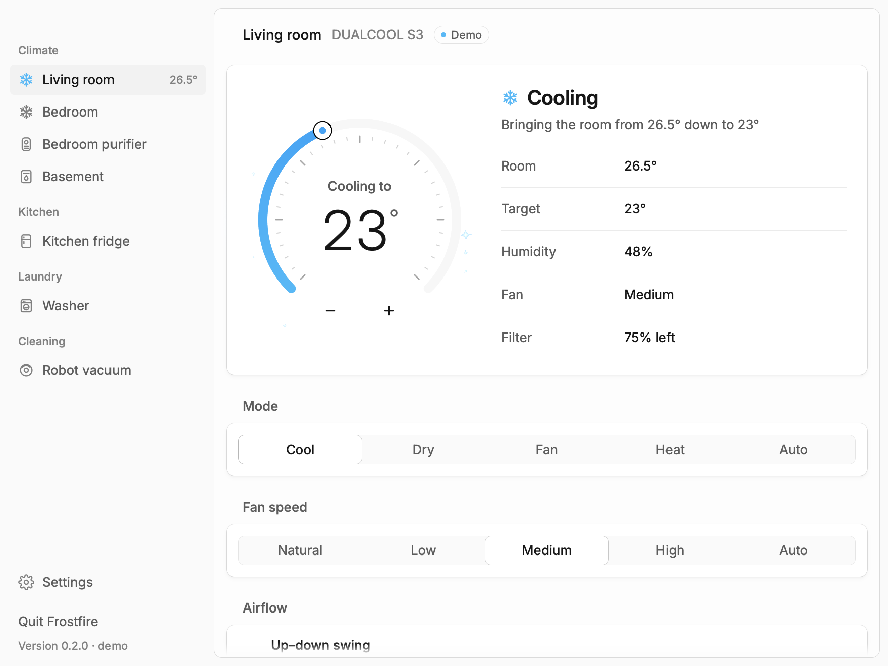
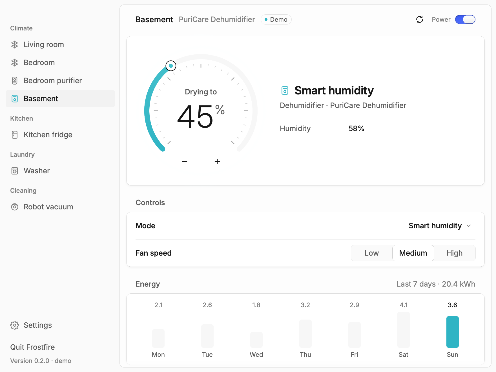
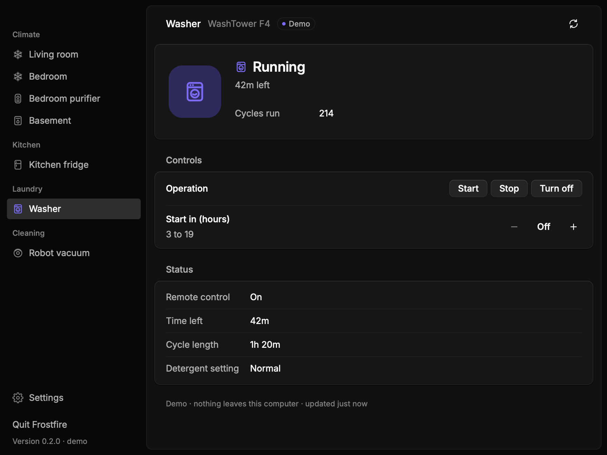
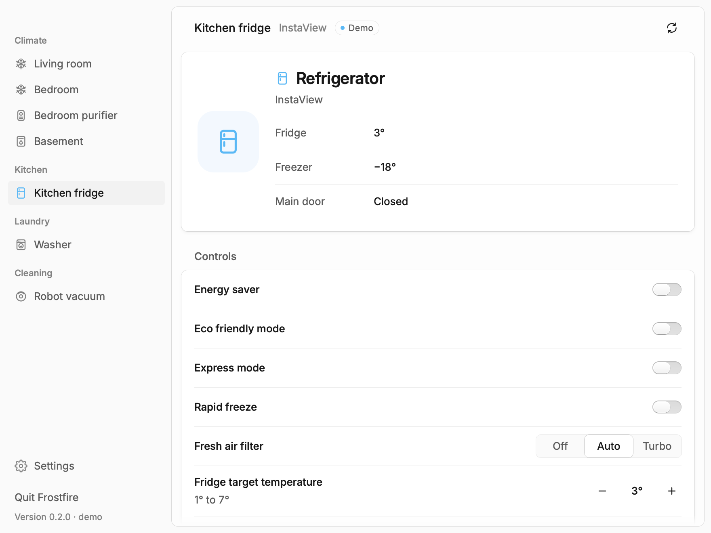
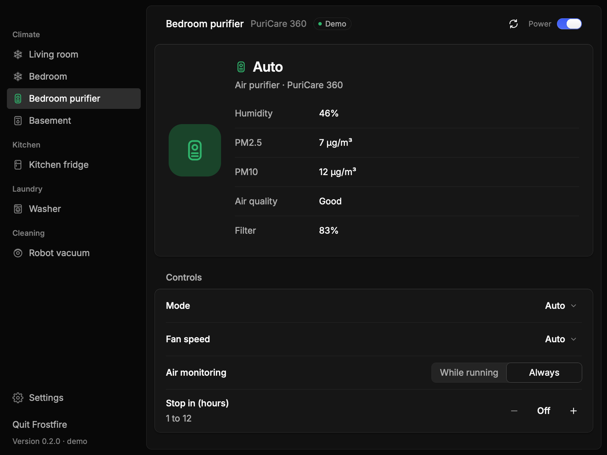
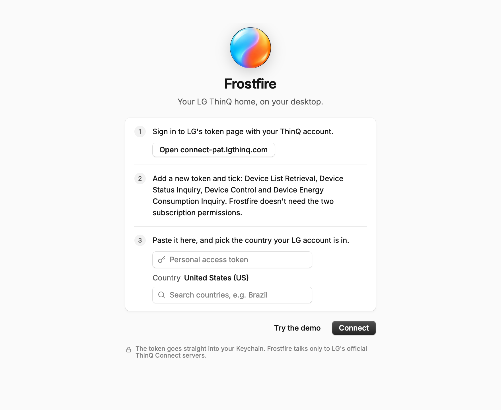

<p align="center"></p>

# Frostfire

Frostfire runs your LG ThinQ home from your desktop: air conditioners, purifiers,
dehumidifiers, fridges, washers, robot vacuums and every other appliance on LG's
official API. It's a native, GPU-drawn app built with [Rune](https://github.com/anomalyco/rune),
for macOS, Windows and Linux. On macOS it also lives in the menu bar.



## What it does

- every device on your LG account, in a sidebar grouped by room of the house:
  climate, heating, kitchen, laundry and cleaning
- each device shows what it's doing and every setting LG lets you change for that
  model, and only those: power, modes, fan speeds, targets, timers, start and stop,
  and what it reports (temperatures, humidity, air quality, time left, battery, doors)
- a dial for the thing a device holds: an AC's temperature, a dehumidifier's humidity,
  a water heater's temperature. Drag it, click − and +, or press ↑ and ↓
- air conditioners get their own pane: modes, every fan speed the unit takes, louvre
  positions with a picture of where the air goes, swing, energy saver, air purifying,
  the display light, and turn-off, turn-on and sleep timers
- the last seven days of energy use, for devices that report it
- starting an oven, cooktop or microwave remotely takes a second press, on purpose
- on macOS, the menu bar item shows the room temperature and runs the device from its
  menu; closing the window keeps Frostfire there, and Settings can hide its Dock icon
- frost settles on the dial while cooling and embers rise in it while heating;
  Settings › Effects can calm or stop them, and an idle window draws nothing
- follows the system's light and dark appearance
- a demo home with seven pretend devices, to try it without an LG account

<p>


</p>
<p>


</p>

### How it knows what your device can do

Frostfire doesn't keep a list of models. Every device tells LG's ThinQ Connect API what it
can report and change (its *profile*), and Frostfire draws the device's pane from that,
checking every change against it before sending. So a device type Frostfire has never seen
still shows everything LG exposes for it. If LG's API can't set something for your model,
like a fan speed only the remote has, Frostfire says so instead of drawing a control that
wouldn't work.

Frostfire has been tested on real air conditioners. The other device types are built from
LG's published profiles and SDK. If something looks off on yours, please
[open an issue](https://github.com/alycoy/frostfire/issues) with the output of
`--dump-profiles` (below).

## Downloads

Stable is the current release. Dev is the newest build of `main`.

| Platform | Stable | Dev |
| --- | --- | --- |
| macOS 13+ (Apple silicon and Intel) | [DMG](https://github.com/alycoy/frostfire/releases/latest/download/Frostfire.dmg) · [zip](https://github.com/alycoy/frostfire/releases/latest/download/Frostfire-macos.zip) | [DMG](https://github.com/alycoy/frostfire/releases/download/dev/Frostfire.dmg) · [zip](https://github.com/alycoy/frostfire/releases/download/dev/Frostfire-macos.zip) |
| Windows 10+ (x64) | [zip](https://github.com/alycoy/frostfire/releases/latest/download/Frostfire-windows-x64.zip) | [zip](https://github.com/alycoy/frostfire/releases/download/dev/Frostfire-windows-x64.zip) |
| Windows 11 (Arm64) | [zip](https://github.com/alycoy/frostfire/releases/latest/download/Frostfire-windows-arm64.zip) | [zip](https://github.com/alycoy/frostfire/releases/download/dev/Frostfire-windows-arm64.zip) |
| Linux (x64) | [tar.gz](https://github.com/alycoy/frostfire/releases/latest/download/Frostfire-linux-x64.tar.gz) | [tar.gz](https://github.com/alycoy/frostfire/releases/download/dev/Frostfire-linux-x64.tar.gz) |

Every release lists SHA-256 checksums for its files.

The builds aren't signed by Apple or Microsoft yet, so the first launch needs a nod:

- **macOS:** System Settings › Privacy & Security, then **Open Anyway** next to Frostfire.
  Or in Terminal: `xattr -dr com.apple.quarantine /Applications/Frostfire.app`
- **Windows:** if SmartScreen says it protected your PC, click **More info**, then **Run anyway**.
- **Linux:** unpack it and run `./frostfire`, or install it for your user from the
  unpacked folder:

  ```sh
  install -Dm755 frostfire ~/.local/bin/frostfire
  install -Dm644 io.github.alycoy.frostfire.desktop -t ~/.local/share/applications
  install -Dm644 io.github.alycoy.frostfire.png -t ~/.local/share/icons/hicolor/256x256/apps
  ```

  The token is kept by your desktop's Secret Service (GNOME Keyring or KWallet), so one
  needs to be running.

## Connect your LG account

Frostfire uses LG's official [ThinQ Connect API](https://thinq.developer.lge.com/)
with a personal access token, not your LG password.

1. Open [connect-pat.lgthinq.com](https://connect-pat.lgthinq.com) and sign in with your ThinQ account.
2. Add a new token and tick **Device List Retrieval**, **Device Status Inquiry**,
   **Device Control** and **Device Energy Consumption Inquiry**. Frostfire doesn't
   use the two subscription permissions, so leave them off.
3. Paste the token into Frostfire, pick the country your LG account is in, and
   connect.



## Privacy and security

- the token lives in your system's credential store (the macOS Keychain, Windows
  Credential Manager, or the Secret Service on Linux), never in a file; Sign out removes it
- Frostfire talks only to LG's ThinQ Connect servers over HTTPS (the system's TLS),
  with no redirects, a timeout and a cap on response size
- no accounts, analytics, telemetry or servers of its own
- every change is checked against what the device says it accepts before it's sent:
  only settings it lists as writable, only values it lists, numbers clamped to its range
- settings (country, unit, menu bar and Dock) are in a small `config.json` in your
  user config folder, readable only by you
- network, credential and disk work run off the UI thread

Found a security problem? Please open a
[private security advisory](https://github.com/alycoy/frostfire/security/advisories/new)
rather than an issue.


## Build it yourself

You need Rust (the version is pinned in `rust-toolchain.toml`; rustup installs it).
On Linux, Rune also needs the usual windowing headers (see `.github/workflows/ci.yml`).

```sh
cargo run                    # the app
cargo test                   # tests
scripts/bundle.sh            # macOS: dist/Frostfire.app
scripts/package.sh           # macOS: dist/Frostfire.dmg and dist/Frostfire-macos.zip
```

`scripts/bundle.sh` signs with an identity named "Frostfire Local Signing" when
your login keychain has one, so macOS's Keychain "Always Allow" survives rebuilds;
otherwise it signs ad hoc. Set `FROSTFIRE_SIGN` to use another identity.

Debug builds render screenshots without a window or network:

```sh
cargo run -- --snap shot.png --scene cool --scale 2 --size 880x660 --theme dark
```

Scenes: `welcome`, `country`, `cool`, `heat`, `auto`, `dry`, `off`, `settings`,
`purifier`, `dehumidifier`, `fridge`, `washer`, `robot`.

To see what your own devices report to LG's API (type, model, capabilities and state;
never the token), run Frostfire with `--dump-profiles`, for example
`Frostfire.app/Contents/MacOS/Frostfire --dump-profiles`.

## License

[MIT](LICENSE). Frostfire isn't made by or affiliated with LG Electronics; LG and
ThinQ are LG's trademarks.
