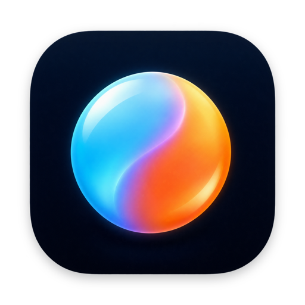
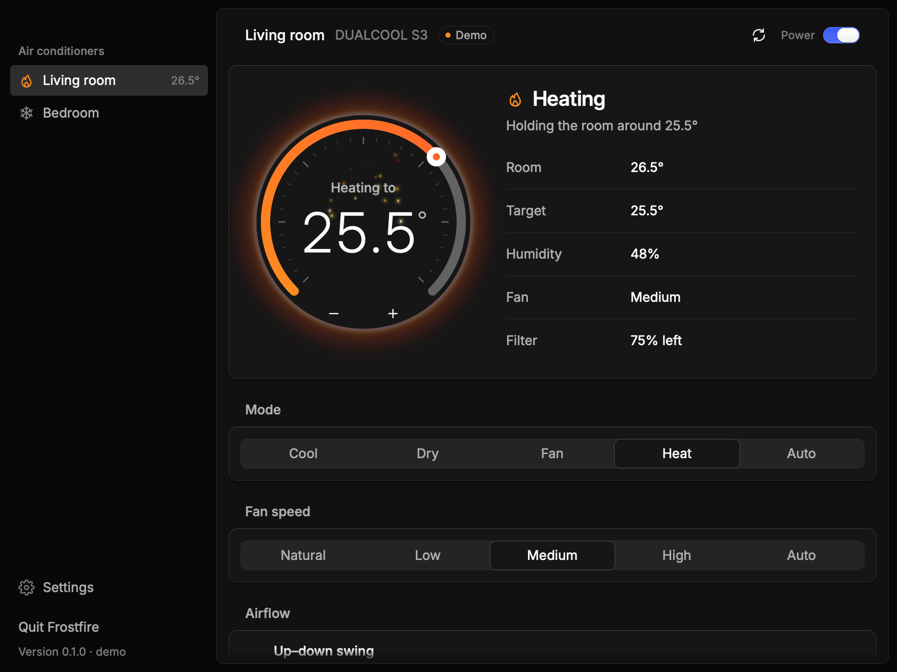
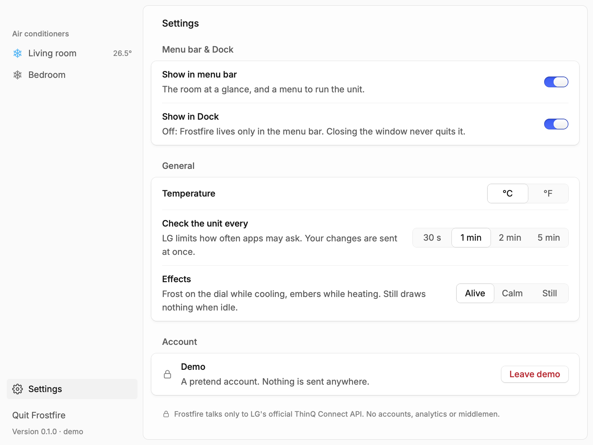

<p align="center"></p>

# Frostfire

Frostfire runs your LG ThinQ air conditioners from your Mac: a native,
GPU-drawn window and a menu bar item, built with [Rune](https://github.com/anomalyco/rune).


## What it does

- the dial sets the target: drag it, click − and +, or press ↑ and ↓
- power, mode (cool, heat, auto, dry, fan), every fan speed the unit takes, swing,
  energy saver, air purifying and the display light
- turn-off, turn-on and sleep timers
- the last seven days of energy use
- several air conditioners on one account, in the sidebar
- the menu bar item shows the room's temperature and runs the unit from its menu:
  power, warmer and cooler, mode, fan, timers and swing
- closing the window keeps Frostfire in the menu bar; Settings can hide its Dock icon
- frost settles on the dial while cooling and embers rise in it while heating;
  Settings › Effects can calm or stop them, and an idle window draws nothing
- follows the system's light and dark appearance
- a demo account with two pretend units, to try it without one

It shows only what your unit reports it can do. LG's API decides that per model:
some units take louvre positions or finer fan speeds, others only swing on or off
and a few speeds. A speed set on the remote that the API can't set still shows,
marked as set on the remote.



## Downloads

Stable is the current release. Dev is the newest build of `main`.

| Platform | Stable | Dev |
| --- | --- | --- |
| macOS 13+ (Apple silicon and Intel) | [DMG](https://github.com/alycoy/frostfire/releases/latest/download/Frostfire.dmg) · [zip](https://github.com/alycoy/frostfire/releases/latest/download/Frostfire-macos.zip) | [DMG](https://github.com/alycoy/frostfire/releases/download/dev/Frostfire.dmg) · [zip](https://github.com/alycoy/frostfire/releases/download/dev/Frostfire-macos.zip) |

Frostfire is macOS only for now: it keeps your token in the macOS Keychain and
lives in the menu bar.

The builds aren't notarized by Apple yet, so the first time you open Frostfire,
macOS stops it. Open it anyway in one of two ways:

- System Settings › Privacy & Security, then **Open Anyway** next to Frostfire
- or in Terminal: `xattr -dr com.apple.quarantine /Applications/Frostfire.app`

Every release lists SHA-256 checksums for its files.

## Connect your LG account

Frostfire uses LG's official [ThinQ Connect API](https://thinq.developer.lge.com/)
with a personal access token, not your LG password.

1. Open [connect-pat.lgthinq.com](https://connect-pat.lgthinq.com) and sign in with your ThinQ account.
2. Add a new token and tick **Device List Retrieval**, **Device Status Inquiry**,
   **Device Control** and **Device Energy Consumption Inquiry**. Frostfire doesn't
   use the two subscription permissions, so leave them off.
3. Paste the token into Frostfire, pick the country your LG account is in, and
   connect.


## Privacy and security

- the token lives in your login Keychain, never in a file; Sign out removes it
- Frostfire talks only to LG's ThinQ Connect servers over HTTPS (the system's TLS),
  with no redirects, a timeout and a cap on response size
- no accounts, analytics, telemetry or servers of its own
- every command is checked against what the unit says it accepts before it's sent,
  and temperatures are clamped to the unit's range
- settings (country, unit, menu bar and Dock) are in
  `~/Library/Application Support/Frostfire/config.json`, readable only by you
- network, Keychain and disk work run off the UI thread

Found a security problem? Please open a
[private security advisory](https://github.com/alycoy/frostfire/security/advisories/new)
rather than an issue.



## Build it yourself

You need Rust (the version is pinned in `rust-toolchain.toml`; rustup installs it).

```sh
cargo run                    # the app
cargo test                   # tests
scripts/bundle.sh            # dist/Frostfire.app
scripts/package.sh           # dist/Frostfire.dmg and dist/Frostfire-macos.zip
```

`scripts/bundle.sh` signs with an identity named "Frostfire Local Signing" when
your login keychain has one, so macOS's Keychain "Always Allow" survives rebuilds;
otherwise it signs ad hoc. Set `FROSTFIRE_SIGN` to use another identity.

Debug builds render screenshots without a window or network:

```sh
cargo run -- --snap shot.png --scene cool --scale 2 --size 880x660 --theme dark
```

Scenes: `welcome`, `country`, `cool`, `heat`, `auto`, `dry`, `off`, `settings`.

To see what your own units report to LG's API (model, capabilities and state;
never the token): `Frostfire.app/Contents/MacOS/Frostfire --dump-profiles`.

## License

[MIT](LICENSE). Frostfire isn't made by or affiliated with LG Electronics; LG and
ThinQ are LG's trademarks.
